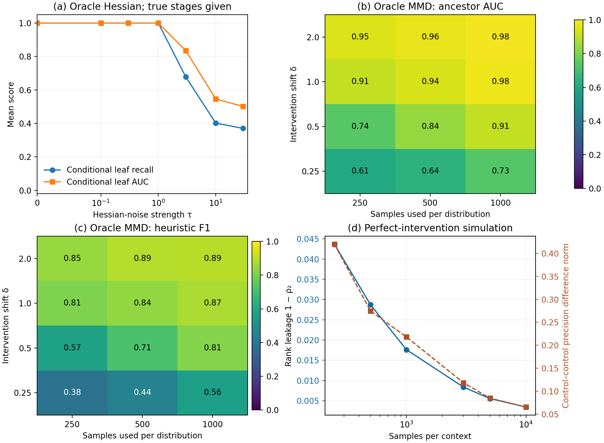
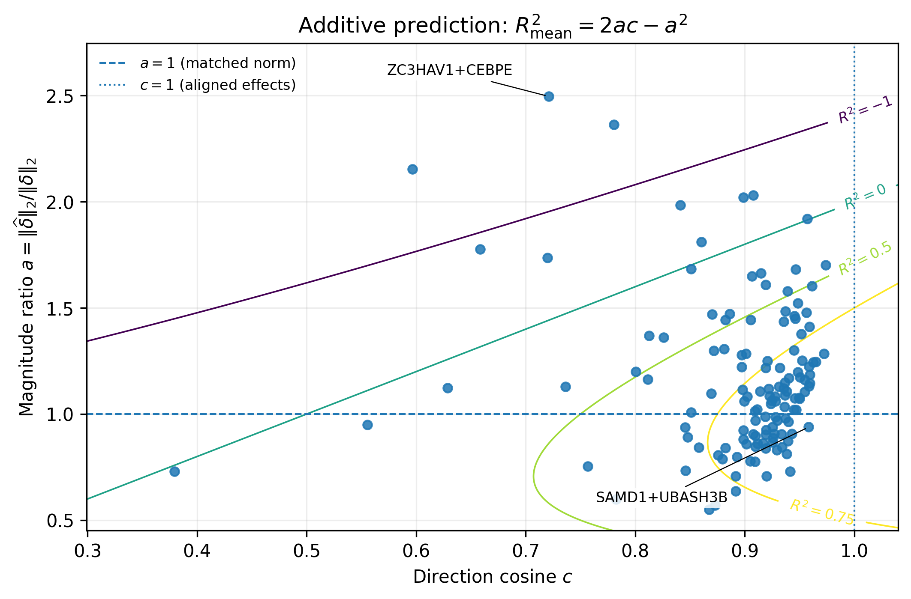

# Causal Disentanglement Across Data Regimes

Advanced Machine Learning course project, Korea University, Spring 2026. Author: Kyung Wook Back.

What can we identify about a latent causal system from observations, soft interventions, or perfect interventions? This project compares three answers to that question, examines their identifying signals in small simulations, and studies perturbation responses in the Norman Perturb-seq data.

**[Read the report](report/report.pdf)** · [Report source and build instructions](report/README.md)

## Synthetic probes

The three papers use different model assumptions. The experiments isolate one signal from each: the observational and soft probes use known latent coordinates, and the perfect-intervention probe uses linearly mixed observations. The full representation-learning estimators are discussed in the report.



- **Observational:** leaf ranking from score-Hessian variation becomes unreliable as injected Hessian noise grows. True peeling stages and leaf counts are supplied.
- **Soft interventions:** marginal shifts separate ancestors more clearly with larger samples and stronger interventions. The plots report MMD-based AUC and heuristic F1.
- **Perfect interventions:** precision differences concentrate near rank two as samples per context increase.

## Norman Perturb-seq

Additive composition beats the control predictor for 121 of 131 double perturbations (median $R^2_{\mathrm{mean}}=0.788$). All 10 negative-$R^2$ cases have a predicted-to-observed norm ratio above 1.7; five still have $c^2>0.7$. Raw expression correlations span 0.939-0.998 and have only a modest association with prediction accuracy (Spearman correlation 0.362 with $R^2$). The direction-and-magnitude view separates errors that these uniformly high correlations obscure.



The analysis uses the public scPerturb distribution. Genes and PCA are fitted using controls and single perturbations. [Data and analysis details](data/norman/README.md) include the source, preprocessing, and saved context means.

## Run

Use Python 3.12 and install the numerical dependencies:

```bash
python -m pip install -r requirements.txt
python run_reproduce.py
```

This rebuilds both figures in `outputs/figures/` from the included tables, recomputing synthetic summaries and Norman pair metrics. A Conda specification is also provided in `environment.yml`.

To rerun the synthetic experiments or run the numerical checks:

```bash
python run_reproduce.py --rerun-synthetic --outdir outputs/rerun
python run_reproduce.py --smoke-tests
```

The full soft-intervention grid uses sample sizes 250, 500, and 1,000, four intervention strengths, and 30 repetitions. Its exact kernel sums take quadratic time in sample size.

## Rerun the Norman analysis

Download the scPerturb AnnData file (699 MB) and run the pipeline:

```bash
python -m pip install -r requirements-data.txt
python scripts/download_norman_data.py
python scripts/run_norman_realdata_experiment.py --h5ad external_data/NormanWeissman2019_filtered.h5ad --label-column perturbation --target-separator _ --n-hvgs 2000 --n-pcs 20 --seed 0 --outdir outputs/norman
```

To plot the new results:

```bash
python scripts/reproduce_report_outputs.py --norman-root outputs/norman/results --outdir outputs/norman_report
```

## Files

| Path | Contents |
| --- | --- |
| `scripts/` | Synthetic probes, Norman analysis, data downloader, and plotting |
| `results/synthetic/` | Per-repetition results, summaries, and settings |
| `data/norman/` | Context means, selected genes, pair metrics, and input metadata |
| `figures/` | Figures used by the README and report |
| `tests/` | Numerical and pipeline checks |
| `report/` | PDF, LaTeX source, and references |

## References

- Welch, Zhang, and Uhler (2024). [Identifiability Guarantees for Causal Disentanglement from Purely Observational Data](https://proceedings.neurips.cc/paper_files/paper/2024/hash/ba2f8120cd723c63e6d72b5a2fd16803-Abstract-Conference.html).
- Zhang et al. (2023). [Identifiability Guarantees for Causal Disentanglement from Soft Interventions](https://papers.neurips.cc/paper_files/paper/2023/hash/9d3a4cdf6f70559e8c6fe02170fba568-Abstract-Conference.html).
- Squires, Seigal, Bhate, and Uhler (2023). [Linear Causal Disentanglement via Interventions](https://proceedings.mlr.press/v202/squires23a.html).
- Norman et al. (2019). *Exploring Genetic Interaction Manifolds Constructed from Rich Single-Cell Phenotypes.* GEO GSE133344. [scPerturb data](https://doi.org/10.5281/zenodo.7041849).

## License and AI assistance

Project code is released under the [MIT License](LICENSE). Data-derived files retain the scPerturb distribution's CC BY 4.0 terms; the cell-level file is downloaded separately. Generative AI assisted with editing, code corrections, and validation; see the disclosure in the report.
